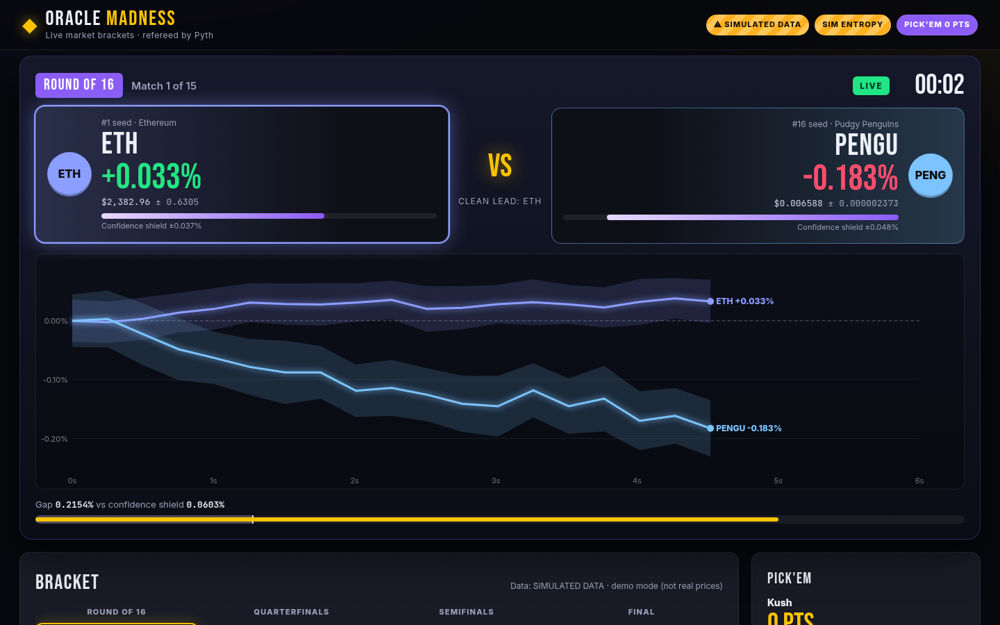

# 🏆 Oracle Madness

**Live market brackets, refereed by Pyth.** A March-Madness bracket where the
competitors are assets (DOGE vs SHIB, BONK vs WIF…). Every match is a live race
on Pyth prices. **Pyth confidence intervals call overtime**, **verifiable randomness
settles sudden death**, and every result comes with an **instant replay** showing the
prices as proof.

> Prototype for the Pyth Community Hackathon, Round 2. Plain HTML/CSS/ES modules:
> no build step, no npm, runs on any static host (cPanel `public_html` is fine).



## How a match works

1. **Seeding:** a commit-reveal random draw shuffles the seeds (1 v 16, 8 v 9, …).
2. **Kick-off:** the app records each asset's Pyth price **and confidence** at the start.
3. **The race:** for the match window (default 30 s), both assets' % change is drawn
   live, with their confidence band as a glowing "shield" around each line.
4. **The referee:** at the buzzer,

   ```
   u   = sqrt( (conf/price)²start + (conf/price)²end ) × 100      // % uncertainty of each asset's move
   gap = |ΔA − ΔB|
   too close to call  ⇔  gap ≤ k · sqrt(uA² + uB²)                 // k = "referee sensitivity", default 1
   ```
   - Clean gap → the bigger % gainer advances.
   - Inside the shield → **OVERTIME** (extra window, measured from the original start).
   - Still inside → **SUDDEN DEATH**: a random number, even → A, odd → B.
5. **Instant replay:** start/end price ± conf, publish times, the maths, and a
   replayable chart. With a Pyth API key, "Verify with Pyth Benchmarks" fetches the
   **signed** historical update for each start/end publish time.
6. **Pick'em:** before tip-off you fill the bracket (10/20/40/80 pts per round on
   16 seeds). Score updates live; finished brackets go on a leaderboard stored in
   `localStorage`.
7. **Prize display:** a USD prize pool converted to DOGE at Pyth DOGE/USD (± conf range).

## Data sources (the badge at the top always says which one is running)

| Source | Key? | What it is | Status (tested 2026-10-18) |
|---|---|---|---|
| **Pyth Hermes via `proxy.php`** | Yes | `/v2/updates/price/latest` polled ~1/s through a tiny PHP proxy; Benchmarks `/v1/updates/price/{ts}` for replay proofs | Code path tested with mocked responses. Public Hermes and Benchmarks now return **401 unauthorized** without a key |
| **Pyth on-chain, Solana push feeds** | **No** | Reads Pyth `PriceUpdateV2` accounts (Pyth Solana Receiver, shard 0) via a free CORS RPC (PublicNode) | ✅ **Works live, no key.** Updates every ~45–60 s, so use ≥120 s windows. Only some feeds are kept fresh (BTC, ETH, SOL, BONK, WIF, MEW, FARTCOIN, PYTH, JUP, JTO, HYPE, W, RENDER, TNSR), hence the "Solana Dog Park 8" bracket |
| **Simulated demo** | No | Random walk in the browser, clearly badged **⚠ SIMULATED DATA** | For fast demos and testing only |
| DOGE/USD for the prize panel | No | `getPriceUnsafe` on the Pyth contract on Arbitrum, with publish age shown | ✅ Works |

"Auto" picks Hermes if the proxy has a key, otherwise Solana (if every feed in the
bracket is fresh), otherwise simulated.

### What still needs a key
Since the 26 Aug 2026 Pyth Core upgrade, **every** Hermes and Benchmarks price route
needs `Authorization: Bearer <key>` (free signup: https://pythdata.app/signup). Only
the feed list (`/v2/price_feeds`) is public. Pyth Pro's History API is keyed too.
Hermes SSE streaming (`/v2/updates/price/stream`) is also 401 without a key.

## Files

```
index.html              the whole app (one page)
css/styles.css          broadcast-style dark theme, responsive, reduced-motion aware
js/app.js               UI + tournament flow
js/engine.js            bracket, referee maths, pick'em scoring (pure functions)
js/sources.js           HermesProxySource · SolanaOnchainSource · DemoSource · readEvmPythPrice
js/entropy.js           SimulatedEntropy (commit-reveal hash chain) · OnchainEntropy placeholder
js/chart.js             dependency-free canvas race chart with confidence bands
js/assets.js            feed IDs (from Hermes /v2/price_feeds), Solana accounts, bracket presets
proxy.php               Hermes/Benchmarks proxy; key read from a file OUTSIDE the web root
config.sample.php       copy to /home/<you>/oracle-madness-config.php and add the key
contracts/              OracleMadnessEntropy.sol (Pyth Entropy v2) + deploy notes
shots/                  screenshots from the headless test run
```

## Run it

**Locally:** any static server works. With PHP installed you also get the proxy:
```bash
php -S 127.0.0.1:8080        # then open http://127.0.0.1:8080
# or: python3 -m http.server 8080   (proxy disabled, Solana + demo still work)
```
Opening `index.html` straight from disk won't work (browsers block ES modules on `file://`).

**On cPanel:**
1. Upload the folder to `public_html/oracle-madness/`.
2. *(For Hermes)* copy `config.sample.php` to `/home/<cpanel-user>/oracle-madness-config.php`
   (one level **above** `public_html`), and paste your Pyth API key into it.
3. Visit `https://yourdomain/oracle-madness/proxy.php?route=health`. You want
   `{"ok":true,"keyConfigured":true}`.
4. Open `https://yourdomain/oracle-madness/`. The badge should say **LIVE · HERMES**.

Useful URL flags: `?demo=turbo` (3 s simulated matches, auto-picks, auto-runs),
`?bracket=doginal16|doginal8|solpark8`, `?src=auto|hermes|solana|demo`,
`?window=30&ot=15&k=1`, `?autostart=1`, `?solrpc=<your Solana RPC>`.

## Randomness
`js/entropy.js` ships **"Simulated Entropy (testnet integration next)"**. It copies
Pyth Entropy's design: the provider commits to the head of a SHA-256 hash chain
*before* any draw, every request mixes a fresh browser random number with the next
revealed chain value, and the UI shows that `SHA256(reveal) == previous commitment`.
It is clearly labelled as simulated. The real Entropy v2 contract and Base Sepolia
deploy steps are in [`contracts/`](contracts/README.md).

## Testing done
- Headless Chrome (puppeteer-core): full 16-seed tournament in turbo mode, all 15
  matches including overtime and sudden death; 8-seed mobile run (390 px); a keyless
  live run on Solana push feeds; the Hermes path with mocked proxy responses.
  **No console errors or page errors.**
- `php -l` on `proxy.php`; proxy tested for health, missing key (503), rejected key
  (Hermes 403 passed through) and bad feed IDs (400).
- Contract compiled with solc 0.8.24 against `@pythnetwork/entropy-sdk-solidity`.

## Known limits
- No API key on hand, so live Hermes data and real Benchmarks proofs haven't been
  seen end to end yet. The code follows the documented response shapes.
- Keyless Solana feeds update every ~45–60 s, so races move in steps; short windows
  end in ties (→ overtime → sudden death). That's correct behaviour, just less exciting.
- Randomness is simulated in the browser; the Entropy contract isn't deployed.
- Matches run one at a time. A 16-seed bracket with 30 s windows takes ~12–15 min.
- The leaderboard is per-device (`localStorage`), with no accounts and no wagering.

## License
Apache-2.0. See [LICENSE](LICENSE). Price data © Pyth Network contributors.
